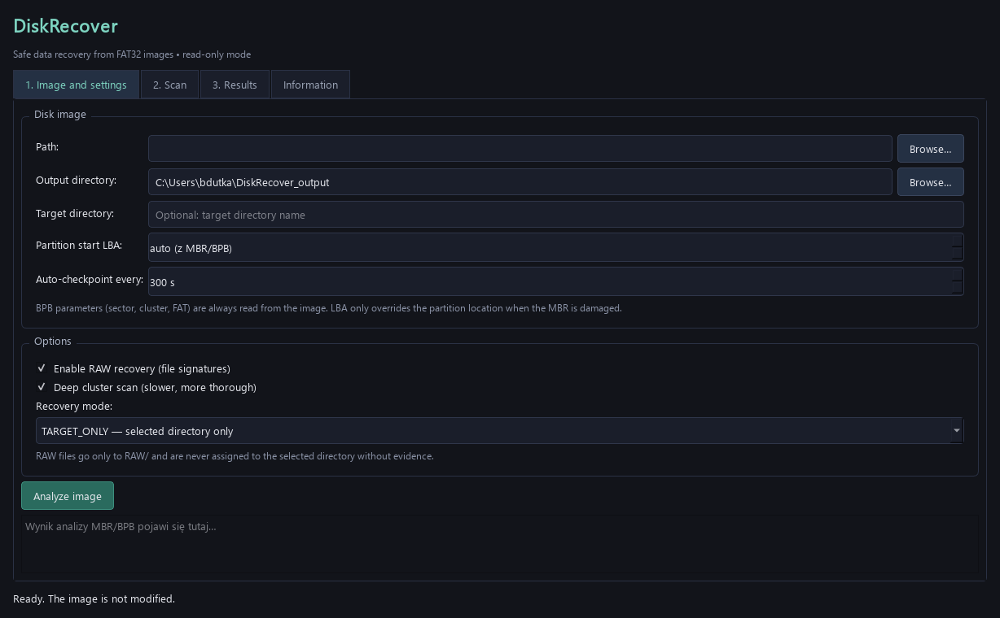
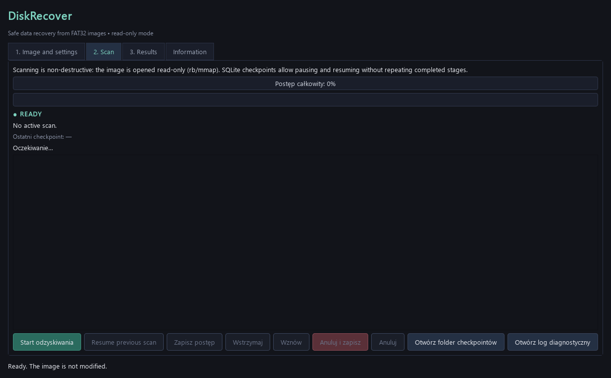
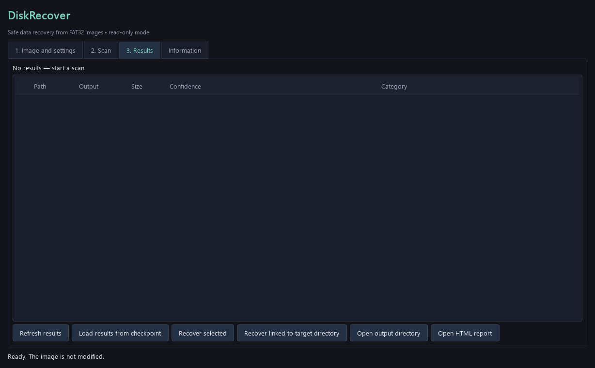
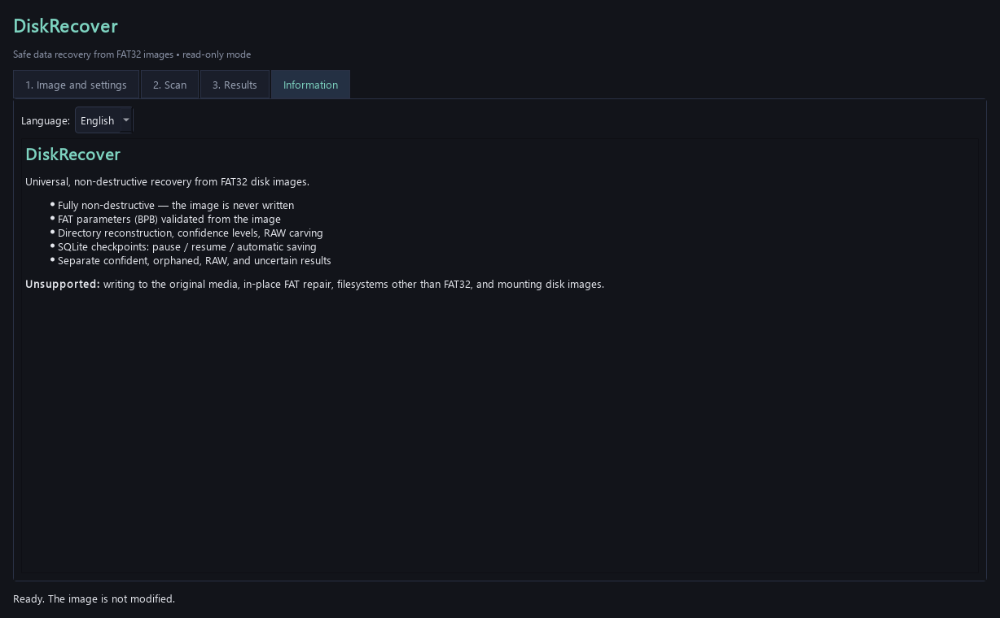

# DiskRecover

DiskRecover is a non-destructive desktop and command-line toolkit for
recovering files from disk images. The currently implemented filesystem
reader is **FAT32**; other filesystems are intentionally reported as
unsupported rather than guessed.

## Features

- Read-only image access (streaming reads or read-only memory mapping).
- MBR partition discovery and BPB-derived FAT32 parameters.
- Quick/full reconstruction, orphan analysis, RAW carving, and checkpoints.
- Safe file validation for PDF, Office/OOXML, OLE/CFB, RTF, and ZIP containers.
- Streaming SHA-256 deduplication with an optional SQLite hash cache.
- Nondestructive export with conflict-safe names and an `export-map.csv`
  provenance file.
- JSON, CSV, and HTML recovery reports.

Validation distinguishes `VALID_STRUCTURE`, `PARTIALLY_RECOVERED`,
`CORRUPTED`, `UNVERIFIED`, `ENCRYPTED`, and `DUPLICATE`. A valid structure
does not guarantee that the document's contents are complete or readable.
No recovered document is opened by an office application, and no macros or
active content are executed.

## Screenshots

The screenshots below are generated from the current PySide6 application
window. The interface is intentionally dark and keeps source images
read-only throughout the workflow.

### Source and recovery settings

Choose an image and output directory, optionally provide a target directory,
and select RAW carving, deep scanning, or targeted recovery.



### Scan progress

The scan view reports overall and stage progress, telemetry, checkpoint state,
and controls for pausing, resuming, saving, or cancelling a scan.



### Recovery results

Recovered objects are shown in a table with their source path, output path,
size, confidence, and category. Results can be refreshed or exported without
rescanning the image.



### Safety and capabilities

The information view summarizes the non-destructive design and current
filesystem support. English is selected by default; the language selector
also provides Polish and updates the visible interface immediately.



## Installation

Python 3.10 or newer is required.

```powershell
python -m venv .venv
.venv\Scripts\activate
pip install -r requirements.txt
```

## Usage

```powershell
python -m diskrecover gui
python -m diskrecover analyze C:\path\image.bin
python -m diskrecover recover C:\path\image.bin -o C:\path\output --no-raw
python -m diskrecover validate C:\path\recovered --json
python -m diskrecover export-validated C:\path\recovered -o C:\path\verified --flat
```

`--target` is optional and is only needed for targeted reconstruction.
`--partition-lba` can override partition discovery when an image has damaged
partition metadata. The source image is never modified.

## Supported and unsupported filesystems

FAT32 is the only filesystem reader currently implemented. FAT12, FAT16,
exFAT, NTFS, and ext2/ext3/ext4 are extension targets, not supported input
formats today.

## Development

```powershell
pytest -q
```

The core package is separated into image access, FAT32 parsing, reconstruction,
carving, validation, deduplication, export, persistence, and reporting
modules. The PySide6 GUI and CLI use the same core services.

## Safety and limitations

Use a forensic copy whenever possible. Recovery cannot guarantee complete
content when metadata or data clusters have been overwritten. Do not treat
validation as proof of semantic correctness. Physical-device support and
in-place filesystem repair are deliberately not provided.
